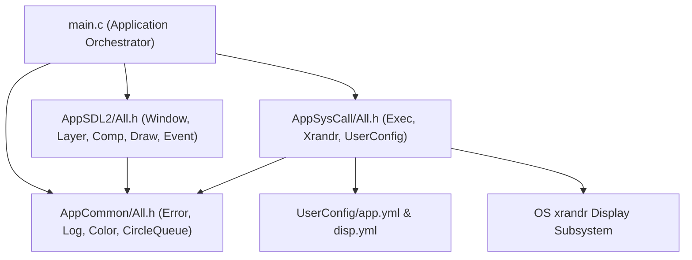

# MDF - MonitorSelection Overall Application Specification (`mdf-app.md`)

## 1. System Overview
**MonitorSelection** is a modular, multi-threaded Linux display layout and property management application written in C11 using **SDL2**, **SDL2_gfx**, **SDL2_ttf**, and **POSIX / xrandr** system calls.

The project is organized into three self-contained modules and one top-level application entry point:
1. **`AppCommon/`** ([mdf-app-common.md](file:///home/fus/Documents/MonitorSelection/AppCommon/mdf-app-common.md)): Core types, `Err_t` status codes, structured logging (`APP_DBG`, `APP_INFO`, `APP_WARN`, `APP_ERR`), parameter assertion macros (`PARAM_CHECK_EN`), `Color_t` (`AARRGGBB`), and generic ring-buffer `CircleQueue_t`.
2. **`AppSDL2/`** ([mdf-app-sdl2.md](file:///home/fus/Documents/MonitorSelection/AppSDL2/mdf-app-sdl2.md)): Multi-layered UI engine (`g_MainWindow`), single-instance lock & window toggle, 0–360 degree rotated components & layer `RectClip`, word-wrapped/aligned multi-line text, magnetic edge/corner snapping (`CompSnapMagnetsTogether`), and sleeping/waking event & render queues.
3. **`AppSysCall/`** ([mdf-app-syscall.md](file:///home/fus/Documents/MonitorSelection/AppSysCall/mdf-app-syscall.md)): OS script execution (`SysCallExecScript`, `SysCallExecCapture`), environment & filesystem helpers, `xrandr` display query/apply/verify/safe-rollback (`SysCallXrandrApplySafe`), and YAML configuration persistence (`UserConfig/app.yml` and `UserConfig/disp.yml`).
4. **`main.c`** ([main.c](file:///home/fus/Documents/MonitorSelection/main.c)): Orchestrates the 4-thread runtime architecture, 3 UI layers, auto top-left origin `(0, 0)` relative coordinate engine, `Roll-back` / `Apply` workflow, and right-side vertical Property Panel.

---

## 2. Architecture & Module Hierarchy



---

## 3. Multi-Threaded Sleeping/Waking Architecture
All threads sleep on OS event queues or `SDL_cond` condition variables when idle (zero busy-wait polling):

| Thread | Entry Function | Responsibility | Wakeup Trigger |
| :--- | :--- | :--- | :--- |
| **1. Main Thread** | `main` | Owns the SDL2 renderer, waits for OS/UI events via `EventWaitOSOnMainThread`, and drains `g_MainWindowUpdateQueue` via `WindowQueueProcessAll`. | OS input event or `WindowWakeupMainThread` (`SDL_PushEvent`). |
| **2. Event Listener Thread** | `EventListenerThreadEntry` | Pops `EventData_t` items from `g_EventQueue`, performs hit-testing, manages drag-and-drop state (`g_DragDropCtx`), and invokes component callbacks (`OnCardSelectClick`, `OnCardDragStart`, `OnCardDrop`, `OnBtnRollbackClick`, `OnBtnApplyClick`, `OnBtnRes*`, `OnBtnFreq*`). | `EventPushToListenerQueue` (`SDL_CondSignal`). |
| **3. Card Monitor Thread** | `CardMonitorThreadEntry` | Prevents card overlap, snaps edges/corners within `SnapThresholdPx` via `MakeSnapMagnetsTogether`, auto-detects the top-left origin card `(0, 0)`, updates relative `POS(x, y)` on all cards, and refreshes the Property Panel. | Immediately on `OnCardDrop` / `OnBtnRollbackClick` (`SDL_CondBroadcast`) or periodic 100 ms timeout. |
| **4. Misc Background Thread** | `MiscBackgroundThreadEntry` | Pulses the header status indicator (`StatusCircle`) and dispatches periodic `EVENT_TYPE_MONITOR` heartbeat signals. | `SDL_CondWaitTimeout` (500 ms) or immediate broadcast on shutdown. |

---

## 4. UI Layer & Component Specification (`g_MainWindow`)

### 4.1 Layer 0: Header Bar & Main Frame (`g_MainWindow.Layers[0]`)
- **`Comp[0][0]` (`MainPanel`)**: Container rounded rectangle (`740x460` at `(30, 30)`).
- **`Comp[0][1]` (`HeaderLine`)**: Horizontal separator line (`(40, 82)` to `(760, 82)`).
- **`Comp[0][2]` (`StatusCircle`)**: Pulsing status indicator circle (`24x24` at `(50, 48)`).
- **`Comp[0][3]` (`HeaderText`)**: Live status message text (`g_StatusMsgBuf`).
- **`Comp[0][4]` (`Roll-back`)**: Restores monitor positions, ON/OFF states, resolutions, and refresh rates from the last snapshot (`g_BackupCfg` & `g_BackupCardDims`) and re-applies via `SysCallXrandrApply`.
- **`Comp[0][5]` (`Apply`)**: Opens a Yes/No confirmation dialog (`WindowShowYesNoDialog`), saves current preferences to `UserConfig/disp.yml` (`SysCallDispPreferSave`), applies via `SysCallXrandrApplySafe` with automatic rollback protection, and updates the backup snapshot.
- **`Comp[0][6]` (`CanvasPanelBg`)**: Rounded container frame (`500x380` at `(40, 95)`, `Radius = 8`) with a cyan border enclosing the 3-monitor layout canvas, matching the rounded style of the right-side Property Panel.

### 4.2 Layer 1: Draggable Monitor Layout Canvas (`g_MainWindow.Layers[1]`)
- **Viewport (`RectClip`)**: `W = 500, H = 380, OffsetX = 40, OffsetY = 95`.
- **Cards (`Comp[1][0..2]`)**: Three draggable monitor cards (`IsDraggable = 1U`, `Class = COMP_CLASS_BUTTON`).
- **Card Text Format & OFF Styling**:
  - When **ON** (`IsEnabled == 1U`):
    ```text
    <Label> | <W>x<H>@<Freq>
    POS(<x>, <Y>)
    ```
  - When **OFF** (`IsEnabled == 0U`): Card background turns pure dark black (`0xFF0A0A0A`), text turns muted gray, and displays:
    ```text
    <Label> | OFF
    POS(<x>, <Y>)
    ```
- **Auto Top-Left Origin & Relative Coordinates**:
  - `UpdateRelativePositionsAndTexts` automatically selects the **active (ON)** card closest to the top-left corner (minimum `OffsetX + OffsetY`, tie-broken by `OffsetY`) as the primary origin `POS(0, 0)`.
  - All other monitor cards compute their `POS(x, y)` relative to the origin card (`rel_x = card.OffsetX - origin.OffsetX`, `rel_y = card.OffsetY - origin.OffsetY`).
- **Anti-Overlap & Magnetic Snapping**:
  - While stationary or immediately upon drop (`OnCardDrop`), `MakeSnapMagnetsTogether` calls `CompSnapMagnetsTogether` so cards never overlap, edges within `SnapThresholdPx` (`25 px`) snap flush together, and corners within `SnapThresholdPx` snap vertex-to-vertex.

### 4.3 Layer 2: Right-Side Vertical Property Panel (`g_MainWindow.Layers[2]`)
- **Viewport (`RectClip`)**: `W = 210, H = 380, OffsetX = 550, OffsetY = 95`.
- **Selection Synchronization**: Clicking a monitor card (`OnCardSelectClick`), starting a drag (`OnCardDragStart`), or dropping a card (`OnCardDrop`) immediately selects that monitor card (`SelectMonitorCard`) and populates the right-side Property Panel:
  - **`Comp[2][0]` (`PropPanelBg`)**: Vertical property panel container (`210x380`, `Radius = 8`).
  - **`Comp[2][1]` (`PropTitle`)**: Selected monitor label and `[ORIGIN]` or `[OFF]` badge (`g_PropTitleBuf`).
  - **`Comp[2][2]` (`PropSepLine`)**: Horizontal divider line.
  - **`Comp[2][3]` (`PropInfo`)**: Multi-line summary showing Display index, Top-Left Origin / Disabled status, live `Rel POS: (x, y)`, and supported mode count.
  - **`Comp[2][4]` (`PropResLabel`)**: Current resolution (`Res: <W>x<H>`).
  - **`Comp[2][5]` (`PropFreqLabel`)**: Current refresh rate (`Freq: <Freq> Hz`).
  - **`Comp[2][6]` (`< Res`) & `Comp[2][7]` (`Res >`)**: Cycle backward/forward through the selected monitor's supported resolutions (`Displays[]`), immediately updating both the Property Panel and the card's `<Label> | <W>x<H>@<Freq>` text.
  - **`Comp[2][8]` (`< Freq`) & `Comp[2][9]` (`Freq >`)**: Cycle backward/forward through the selected resolution's supported refresh rates (`Freq[]`), immediately updating both the Property Panel and the card's text.
  - **`Comp[2][10]` (`State: ON/OFF` - `OnBtnPowerToggleClick`)**: Toggles the selected monitor between `ON` (`IsEnabled = 1`) and `OFF` (`IsEnabled = 0`, `xrandr --output <Label> --off`, card turns black). Prevents turning OFF the last remaining active monitor so at least 1 display always stays ON.
  - **`Comp[2][11]` (`Set as Primary` / `Primary: YES (Active)` - `OnBtnPrimaryClick`)**: Marks the selected active (`ON`) monitor as the sole `Primary` display (`IsPrimary = 1U`, `xrandr --primary`), clearing `IsPrimary` on all other monitors and appending `*` to the primary card's header (`<Label>* | <W>x<H>@<Freq>`).

---

## 5. Configuration Files (`UserConfig/`)
- **[UserConfig/app.yml](file:///home/fus/Documents/MonitorSelection/UserConfig/app.yml)**: Stores application-level settings (`PreferDispPath`, `SnapThresholdPx`, `MainWindow` dimensions/title, declarative Layer/Component hierarchy, and extensible `ApplyCallBack` post-Apply shell commands `cmd0..cmd31` executed via `SysCallAppRunApplyCallbacks`).
- **[UserConfig/disp.yml](file:///home/fus/Documents/MonitorSelection/UserConfig/disp.yml)**: Stores per-display preferred settings (`Disp0`, `Disp1`, `Disp2` with `Enabled`, `Primary`, `W`, `H`, `Freq`, `PosX`, `PosY`), loaded at startup via `SysCallDispPreferLoad` and updated on `Apply` via `SysCallDispPreferSave`.


